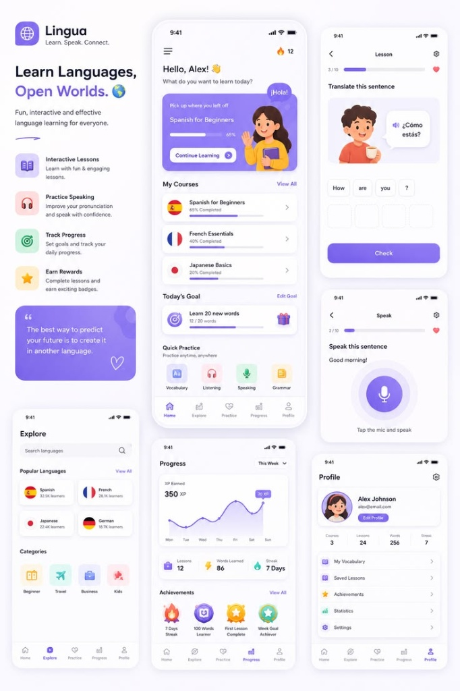

# 🎨 Design System & UI/UX Guidelines: Lingua E-Course App



> **Dokumen Arsitektur & PRD Terkait**: [docs/prd.md](prd.md)  
> Dokumen ini merupakan panduan resmi standar desain antarmuka (*Design System & UI/UX Guidelines*) untuk aplikasi **Lingua E-Course & LMS SMK**, yang dirancang dengan presisi visual modern, konsistensi token, hierarki informasi yang jelas, dan implementasi komponen berbasis **Tailwind CSS + DaisyUI + Vue.js (Inertia.js) & Filament UI**.

---

## 📌 1. Prinsip Utama & Filosofi Desain

Aplikasi Lingua mengedepankan pengalaman belajar yang menyenangkan (*engaging*), bersih (*clean*), dan ringan (*lightweight*). Khusus untuk platform pembelajaran berbasis sekolah/LMS, diterapkan prinsip desain berikut:

1. **Satu Identitas Visual yang Konsisten**: Seluruh elemen warna, tipografi, radius sudut, dan tata letak memiliki token terukur yang seragam di seluruh modul aplikasi.
2. **Desain Bersih & Fungsional (Anti Over-decoration)**:
   - Hindari penggunaan *gradient* dan *glassmorphism* berlebihan di setiap sudut.
   - Tidak semua elemen dibuat menjadi *card*. Gunakan **tabel** untuk rekap nilai/data, **daftar list** untuk modul/materi belajar, dan **panel/card** hanya untuk ringkasan metrik atau hero progress.
3. **Prioritas Hierarki Informasi**:
   - Siswa dapat langsung melihat status belajar aktif, modul terakhir yang sedang dikerjakan (*Pick up where you left off*), dan target belajar harian tanpa terhalang menu yang rumit.
4. **Dashboard Spesifik Berdasarkan Peran (Role-Based UX)**:
   - **Dashboard Siswa**: Interaktif, visual gamifikasi (progres bar, streak, target harian, modul cepat).
   - **Dashboard Guru**: Fokus pada efisiensi kerja (tabel rekap nilai, daftar pengumpulan tugas, manajemen kelas).
   - **Dashboard Kepala Sekolah / Admin (Filament UI)**: Analisis agregat institusi, KPI capaian kurikulum, dan manajemen otentikasi/kebijakan akses (*Laravel Policies & Middleware*).
5. **Animasi Mikro Bertujuan (Purposeful Micro-interactions)**: Animasi hanya dipakai untuk respons interaksi (klik tombol, transisi halaman SPA tanpa reload via Inertia.js, animasi denyut/pulse saat merekam suara), bukan sekadar hiasan statis.
6. **🛑 ATURAN MUTLAK IKON (100% Zero-Emoji as UI Icons)**:
   - **DILARANG KERAS** menggunakan emoji Unicode (seperti 🔥, ❤️, ⭐, 📚, 🎧, 🎙️) sebagai ikon navigasi atau penanda antarmuka UI.
   - **WAJIB** memanfaatkan pustaka ikon vektor SVG murni seperti **Heroicons (Blade/Vue)** atau **Lucide Icons** dengan *stroke/fill* yang dapat dikontrol dinamis melalui CSS.

---

## 🌈 2. Palet Warna (Color Palette & Design Tokens)

### A. Primary & Accent Colors
| Nama Token | Nilai HEX / CSS | Deskripsi & Penggunaan |
| :--- | :--- | :--- |
| **Primary Indigo / Purple** | `#6C5CE7` | Warna aksen utama, tombol CTA primer, indikator tab aktif, progress bar aktif. |
| **Primary Purple Dark** | `#5B4BC4` | Status *hover/active* tombol primer. |
| **Light Purple Accent** | `#EEEDFE` / `#E8E5FF` | Latar belakang chip aktif, highlight kategori, hover state. |
| **Hero Gradient** | `linear-gradient(135deg, #7C69EF 0%, #9080F4 100%)` | Latar belakang kartu hero progress siswa ("Pick up where you left off"). |

### B. Neutral Colors
| Nama Token | Nilai HEX | Penggunaan |
| :--- | :--- | :--- |
| **Background Canvas** | `#F8F9FD` | Latar belakang seluruh halaman aplikasi (lembut, tidak silau). |
| **Surface White** | `#FFFFFF` | Latar belakang kartu, modal, popover, dan panel kontainer. |
| **Text Primary (Dark)** | `#1E1F24` | Judul utama (Headings), teks instruksi penting. |
| **Text Secondary (Muted)** | `#6E717C` | Teks keterangan, deskripsi, sub-heading, metadata waktu. |
| **Border & Divider** | `#F0F1F5` | Garis pembatas kartu, separator list, dan border tabel halus. |

### C. Functional & Gamification Colors
| Kategori | Token Warna | Nilai HEX | Penggunaan UI |
| :--- | :--- | :--- | :--- |
| **Streak / Focus** | `Streak Orange` | `#FF7A00` | Penanda jumlah hari belajar berturut-turut (*streak*). |
| **Health / Lives** | `Red Accent` | `#FF4D4D` | Jumlah nyawa/kuota kuis (*Lives*). |
| **Success** | `Emerald Green` | `#00B894` | Indikator jawaban benar, status tuntas. |
| **Warning** | `Amber Yellow` | `#FDCB6E` | Tenggat tugas mendekat, notifikasi peringatan. |

### D. Pastel Category Colors (Quick Practice & Modul)
| Kategori Modul | Background Chip | Aksen Ikon |
| :--- | :--- | :--- |
| **Vocabulary** | `#FFF5E5` (Pastel Yellow) | `#E17055` / `#D35400` |
| **Listening** | `#FFEEF0` (Pastel Pink) | `#E84393` / `#D63031` |
| **Speaking** | `#E8FAF0` (Pastel Green) | `#00B894` / `#27AE60` |
| **Grammar** | `#EBF3FE` (Pastel Blue) | `#0984E3` / `#2980B9` |

---

## 🔤 3. Tipografi (Typography)

Sistem tipografi menggunakan jenis huruf Sans-Serif modern berkarakter ramah dan mudah dibaca: **Plus Jakarta Sans** (primer) atau **Inter** sebagai alternatif fallback.

| Skala Tipografi | Ukuran | Bobot (Weight) | Line-height | Tracking / Spacing | Penggunaan |
| :--- | :--- | :--- | :--- | :--- | :--- |
| **Heading XL** | `32px` (`2rem`) | Bold (`700`) | `1.2` | `-0.02em` | Judul hero landing page, skor capaian akhir. |
| **Heading L** | `22px` (`1.375rem`) | Bold (`700`) | `1.3` | `-0.01em` | Salam header aplikasi (*"Hello, Alex!"*), judul halaman. |
| **Heading M** | `16px` (`1rem`) | SemiBold (`600`)| `1.4` | `normal` | Judul seksi (*"My Courses"*, *"Today's Goal"*). |
| **Body Normal** | `14px` (`0.875rem`)| Regular / Medium | `1.5` | `normal` | Paragraf soal, instruksi belajar, konten tabel. |
| **Caption / Small**| `12px` (`0.75rem`) | Regular / SemiBold| `1.4` | `+0.01em`| Metadata, label status badge, tab bottom bar. |

---

## 🛡️ 4. Sistem Ikonografi Vektor (Bebas Emoji)

Setiap ikon dibuat menggunakan format vektor SVG (`heroicons` atau `lucide-vue-next`). Emoji dilarang digunakan sebagai elemen ikon.

| Elemen UI | Ikon SVG yang Ditentukan | Format / Kelas Tailwind | Catatan Tampilan |
| :--- | :--- | :--- | :--- |
| **Streak Tracker** | `heroicon-s-fire` (Flame Solid) | `text-[#FF7A00] w-5 h-5` | Menggantikan emoji 🔥 |
| **Lives / Heart** | `heroicon-s-heart` (Heart Solid) | `text-[#FF4D4D] w-5 h-5` | Menggantikan emoji ❤️ |
| **Logo / Language**| `heroicon-o-globe-alt` | `text-[#6C5CE7] w-6 h-6` | Ikon bola dunia di navbar & landing. |
| **Vocabulary** | `heroicon-o-book-open` | `text-[#D35400] w-6 h-6` | Ikon buku terbuka latar pastel kuning. |
| **Listening** | `heroicon-o-headphones` | `text-[#E84393] w-6 h-6` | Ikon headphone latar pastel pink. |
| **Speaking** | `heroicon-o-microphone` | `text-[#00B894] w-6 h-6` | Ikon mikrofon latar pastel hijau. |
| **Grammar** | `heroicon-o-pencil-square` | `text-[#0984E3] w-6 h-6` | Ikon catatan/pena latar pastel biru. |
| **Search Bar** | `heroicon-o-magnifying-glass` | `text-gray-400 w-5 h-5` | Ikon pencarian rounded explore. |
| **Gift / Goal** | `heroicon-o-gift` | `text-purple-600 w-5 h-5` | Ikon kado pada capaian target harian. |
| **Achievements** | `heroicon-o-trophy` / `star` | `text-amber-500 w-6 h-6` | Ikon lencana medali & prestasi. |
| **Navigasi Home** | `heroicon-o-home` / `heroicon-s-home`| `w-6 h-6` | Tab beranda aplikasi. |
| **Navigasi Explore**| `heroicon-o-compass` | `w-6 h-6` | Tab jelajah kursus & bahasa. |
| **Navigasi Practice**| `heroicon-o-academic-cap` | `w-6 h-6` | Tab latihan interaktif & kuis. |
| **Navigasi Progress**| `heroicon-o-chart-bar` | `w-6 h-6` | Tab statistik XP dan rekap. |
| **Navigasi Profile**| `heroicon-o-user` | `w-6 h-6` | Tab profil dan pengaturan akun. |

---

## 📐 5. Spesifikasi Komponen UI (UI Components)

### A. Buttons (Tombol)
1. **Primary Action Button (Ungu Solid)**:
   - **Background**: `#6C5CE7`
   - **Hover**: `#5B4BC4`
   - **Text**: `#FFFFFF`, font-weight `600`, ukuran `14px`.
   - **Border Radius**: `16px` (`rounded-2xl`) atau *pill* (`rounded-full`).
   - **Padding**: `14px 24px`
   - **Shadow**: `0 8px 20px rgba(108, 92, 231, 0.25)`

2. **Secondary / Glass Button (Tombol "Continue Learning")**:
   - **Background**: `rgba(255, 255, 255, 0.9)` (atau solid putih pada kartu hero ungu).
   - **Text**: `#6C5CE7`, font-weight `600`, ukuran `13px`.
   - **Border Radius**: `9999px` (`rounded-full`).
   - **Padding**: `10px 20px`
   - **Efek**: Sedikit scaling saat hover (`hover:scale-105 transition-transform`).

3. **Word Chips (Opsi Kata untuk Jawaban)**:
   - **Background**: `#FFFFFF`
   - **Border**: `1.5px solid #F0F1F5`
   - **Shadow**: `0 2px 6px rgba(0,0,0,0.03)`
   - **Border Radius**: `14px`
   - **State Terpilih / Kosong**: Latar abu-abu redup `#F4F5F9` dengan border putus-putus (*dashed*).

### B. Cards & Containers
1. **Hero Progress Card ("Pick up where you left off")**:
   - **Latar Belakang**: `linear-gradient(135deg, #7C69EF 0%, #9080F4 100%)`
   - **Sudut Lengkung**: `24px` (`rounded-3xl`)
   - **Dekorasi**: Watermark lingkaran lembut semi-transparan (`opacity-10`) di pojok kartu.
   - **Isi**: Label "Pick up where you left off", Judul Modul, Progress Bar putih transparan (65%), tombol CTA putih melengkung.
   - **Ilustrasi**: Sisi kanan memuat karakter pendukung 2D/vektor ramah.

2. **White Standard Card**:
   - **Latar Belakang**: `#FFFFFF`
   - **Border Radius**: `20px`
   - **Box Shadow**: `0px 4px 16px rgba(0, 0, 0, 0.04)`
   - **Padding**: `16px 20px`

3. **Quick Practice Category Chip**:
   - Bentuk kotak bersudut lembut `rounded-2xl`.
   - Menggunakan warna pastel masing-masing modul dengan ikon SVG di tengah dan label teks 12px di bawahnya.

### C. Navigation Bar (Bottom Navigation & Desktop Sidebar)
- **Mobile Bottom Bar**:
  - Background: `#FFFFFF` dengan garis batas atas halus `border-t border-[#F0F1F5]`.
  - 5 Tab Item: *Home*, *Explore*, *Practice*, *Progress*, *Profile*.
  - Status Aktif: Teks & ikon berubah ke `#6C5CE7` disertai titik penanda kecil (*indicator dot*) di bawahnya.
  - Status Tidak Aktif: Teks & ikon berwarna `#A0A5B5`.
- **Desktop Sidebar**:
  - Menyediakan navigasi vertikal responsif dengan logo Lingua di bagian atas, menu utama di tengah, dan profil ringkas di bagian bawah.

---

## 📱 6. Perincian Tata Letak Layar (Screen Layouts)

### Layar 1: Landing Page / Web Header
- **Top Bar**: Logo Lingua dengan ikon vektor Globe + Tombol CTA "Masuk / Mulai Belajar".
- **Hero Title**:
  - Teks: `"Learn Languages, "` dalam warna hitam gelap `#1E1F24` + `"Open Worlds."` dengan gradasi ungu violet.
  - Sub-judul: `"Fun, interactive and effective language learning for everyone."`
- **Feature Showcase Grid**: 4 baris item fitur dengan ikon vektor SVG berlatar pastel:
  1. *Interactive Lessons* (Ikon Buku Vektor)
  2. *Practice Speaking* (Ikon Headphone Vektor)
  3. *Track Progress* (Ikon Target Vektor)
  4. *Earn Rewards* (Ikon Bintang Vektor)
- **Quote Banner**: Banner ungu bertepi lengkung dengan kutipan inspiratif dan watermark tanda kutip ganda.

### Layar 2: Home Screen (Dashboard Belajar)
- **Header**:
  - Sapaan personal: `"Hello, Alex!"` + Subtitle `"What do you want to learn today?"`
  - Badge Streak Kanan Atas: Ikon SVG api oranye `#FF7A00` + Angka hari berturut-turut (misal: `12`).
- **Hero Section**: Kartu bergradasi ungu berisi progres kursus terakhir (*"Spanish for Beginners"* - 65%) + tombol *"Continue Learning >"*.
- **Section "My Courses"**: Daftar kartu kursus yang diikuti lengkap dengan bendera negara, nama bahasa, progres capaian, dan ikon panah navigasi.
- **Section "Today's Goal"**: Indikator capaian target harian (*"Learn 20 new words"* - 12/20) dilengkapi ikon hadiah vektor.
- **Section "Quick Practice"**: 4 kotak mini pastel:
  - 🟦 *Vocabulary* (Ikon Buku Terbuka)
  - 🟥 *Listening* (Ikon Headphone)
  - 🟩 *Speaking* (Ikon Mikrofon)
  - 🟨 *Grammar* (Ikon Lembar Catatan)

### Layar 3: Interactive Lesson (Quiz / Word Scramble)
- **Header**: Tombol tutup/kembali + Progress bar kuis (misal: 3/10) + Indikator Nyawa (Ikon SVG Hati Merah).
- **Soal / Perintah**:
  - Teks: *"Translate this sentence"*
  - Bubble Chat percakapan dengan ikon speaker audio untuk mendengarkan lafal kalimat (*"¿Cómo estás?"*).
- **Answer Slots**: Barisan kotak kosong untuk meletakkan kata yang tersusun.
- **Word Chips**: Kumpulan tombol kata acak (*"How"*, *"are"*, *"you"*, *"?"*) yang dapat disentuh untuk berpindah ke slot jawaban.
- **Bottom Footer**: Tombol CTA lebar penuh berwarna ungu solid (*"Check"* / *"Periksa"*).

### Layar 4: Voice / Speaking Practice Screen
- **Header**: Tombol kembali + Bar progress (2/10) + Ikon hati merah.
- **Instruksi Latihan**: Teks instruksi: *"Speak this sentence"* + Kata yang harus diucapkan: *"Good morning!"*
- **Microphone Interaction Zone**:
  - Lingkaran konsentris gradasi ungu lembut dengan animasi denyut (*subtle pulse animation*).
  - Ikon mikrofon putih di lingkaran inti ungu `#6C5CE7`.
  - Teks petunjuk di bawah lingkaran: *"Tap the mic and speak"*.

### Layar 5: Explore Screen (Katalog Pembelajaran)
- **Search Bar**: Kotak input pencarian bersudut bulat (*rounded-full*) dengan latar `#F8F9FD` dan ikon kaca pembesar SVG.
- **Section "Popular Languages"**: Grid kartu bahasa populer (Spanyol, Prancis, Jepang, Jerman) menampilkan bendera negara, nama bahasa, dan jumlah pelajar (*"32.5K learners"*).
- **Section "Categories"**: Grid ikon kategori (Beginner, Travel, Business, Kids) dengan latar pastel harmonis.

### Layar 6: Progress & Analytics Screen
- **Filter Header**: Judul *"Progress"* dengan dropdown pilihan rentang waktu (*"This Week"*, *"This Month"*).
- **XP Analytics Chart**: Grafik kurva garis halus (*smooth line chart*) yang menunjukkan perolehan XP harian dengan titik sorot capaian tertinggi.
- **Stats Summary Cards**: Tiga kartu metrik ringkas:
  - 💼 *Lessons*: 12 Sesi
  - ⚡ *Words Learned*: 86 Kosakata
  - 🔴 *Streak*: 7 Hari
- **Achievements Badge Grid**: Deretan medali pencapaian (*7 Days Streak*, *100 Words Learner*, *First Lesson Complete*, *Week Goal Achiever*).

### Layar 7: User Profile Screen
- **Profil Header**: Foto profil avatar melingkar + Nama siswa (*Alex Johnson*) + Email + Tombol *"Edit Profile"*.
- **Ringkasan Angka**: 4 kolom statistik horizontal (*Courses: 3*, *Lessons: 24*, *Words: 256*, *Streak: 7*).
- **Daftar Menu Navigasi Akun**:
  - 📘 *My Vocabulary*
  - 🔖 *Saved Lessons*
  - ⭐ *Achievements*
  - 📊 *Statistics*
  - ⚙️ *Settings*

---

## 🏫 7. Standar Desain Berbasis Peran untuk LMS Sekolah

Untuk memastikan kesesuaian dengan kebutuhan institusi sekolah, antarmuka dibagi berdasarkan tanggung jawab pengguna:

```
                          ┌──────────────────────────┐
                          │   Lingua LMS Platform    │
                          └─────────────┬────────────┘
                                        │
         ┌──────────────────────────────┼──────────────────────────────┐
         ▼                              ▼                              ▼
  [ Dashboard Siswa ]            [ Dashboard Guru ]          [ Dashboard Admin/KS ]
  • Gamified & Friendly          • Efisien & Fungsional      • Agregat & Tata Kelola
  • Hero Card "Lanjut Belajar"   • Tabel Penilaian Tugas     • Panel Admin Filament
  • Latihan Cepat & Kuis         • Rekap Kehadiran Kelas     • KPI Capaian Sekolah
  • Progres XP & Streak          • Manajemen Modul & Soal    • Kebijakan Akses & Role
```

1. **Dashboard Siswa (Aplikasi Web SPA via Inertia + Vue 3)**:
   - Berfokus pada kemudahan akses materi dan memicu motivasi belajar mandiri.
   - Menggunakan komponen *Hero Card*, *Quick Practice*, dan modul kuis interaktif tanpa reload sistem saat navigasi menu.
2. **Dashboard Guru**:
   - Meminimalkan kartu dekoratif; memprioritaskan **tabel data** untuk koreksi nilai, pemantauan ketuntasan belajar siswa per kelas, dan pengelolaan bank soal.
3. **Dashboard Kepala Sekolah & Administrator (Panel Admin Filament)**:
   - Terintegrasi pada rute `/admin` dengan autentikasi `FilamentUser` dan kebijakan akses *Laravel Policies*.
   - Menyajikan metrik institusi: statistik keaktifan guru & siswa, distribusi penguasaan materi, dan manajemen data induk.

---

## 💻 8. Konfigurasi Token Desain (Tailwind & DaisyUI)

Token desain Lingua didaftarkan langsung ke dalam `tailwind.config.js` agar seluruh komponen Vue dan Blade dapat memanggil kelas utilitas standar secara konsisten:

```javascript
// tailwind.config.js
import defaultTheme from 'tailwindcss/defaultTheme';
import forms from '@tailwindcss/forms';
import daisyui from 'daisyui';

export default {
    content: [
        './resources/views/**/*.blade.php',
        './resources/js/**/*.vue',
    ],
    theme: {
        extend: {
            colors: {
                lingua: {
                    primary: '#6C5CE7',
                    'primary-dark': '#5B4BC4',
                    accent: '#EEEDFE',
                    'accent-soft': '#E8E5FF',
                    canvas: '#F8F9FD',
                    surface: '#FFFFFF',
                    dark: '#1E1F24',
                    muted: '#6E717C',
                    divider: '#F0F1F5',
                    streak: '#FF7A00',
                    heart: '#FF4D4D',
                    pastel: {
                        yellow: '#FFF5E5',
                        pink: '#FFEEF0',
                        green: '#E8FAF0',
                        blue: '#EBF3FE',
                    },
                },
            },
            fontFamily: {
                sans: ['"Plus Jakarta Sans"', 'Inter', ...defaultTheme.fontFamily.sans],
            },
            boxShadow: {
                'lingua-card': '0px 4px 16px rgba(0, 0, 0, 0.04)',
                'lingua-primary': '0px 8px 20px rgba(108, 92, 231, 0.25)',
            },
            borderRadius: {
                'card': '20px',
                'hero': '24px',
            },
        },
    },
    plugins: [forms, daisyui],
    daisyui: {
        themes: [
            {
                lingua: {
                    primary: '#6C5CE7',
                    secondary: '#EEEDFE',
                    accent: '#FF7A00',
                    neutral: '#1E1F24',
                    'base-100': '#FFFFFF',
                    'base-200': '#F8F9FD',
                    'base-300': '#F0F1F5',
                    info: '#0984E3',
                    success: '#00B894',
                    warning: '#FF7A00',
                    error: '#FF4D4D',
                },
            },
        ],
    },
};
```
