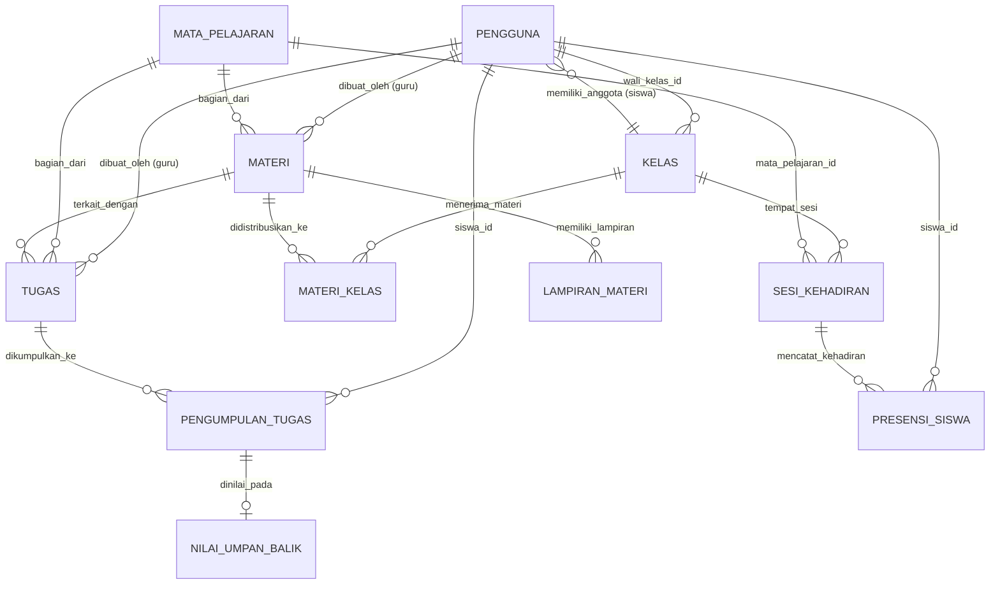
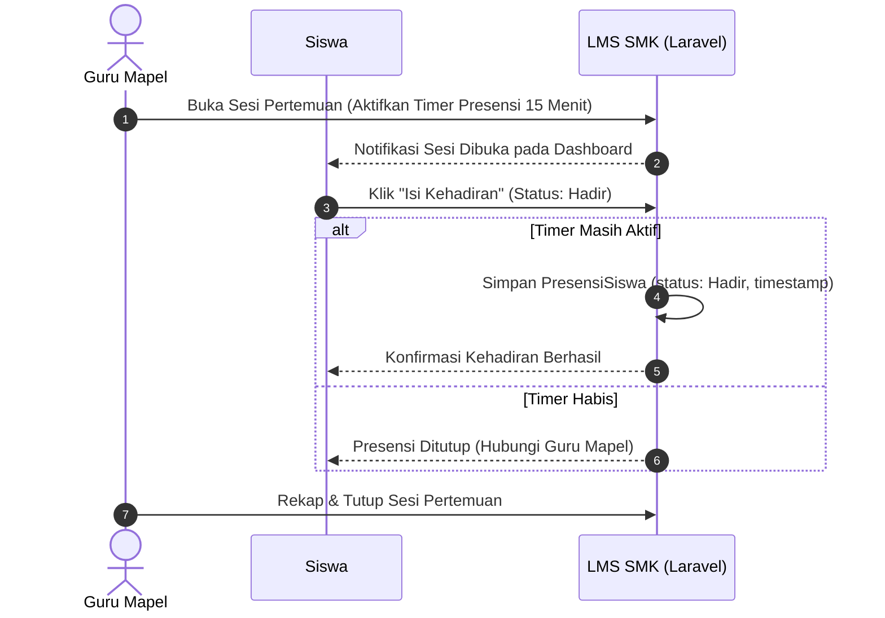
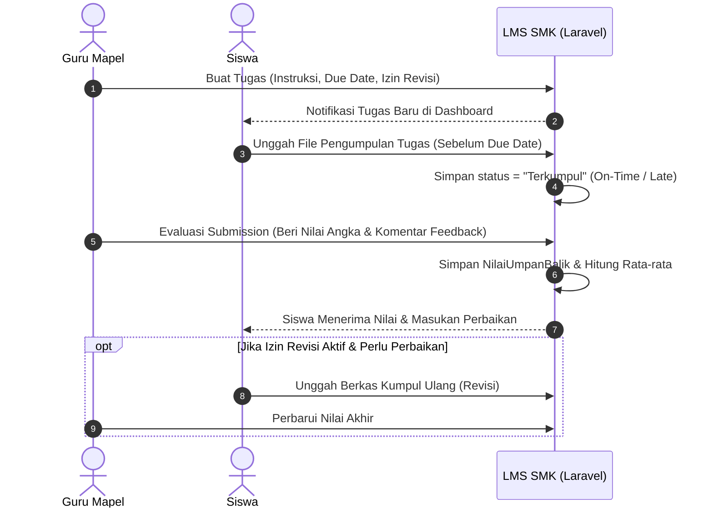

# 📘 Product Requirement Document (PRD) & Architecture Specification
## E-Course / Learning Management System (LMS) SMK

> **Status Dokumen**: Disetujui (Approved)  
> **Target Pengguna**: SMK (Sekolah Menengah Kejuruan)  
> **Arsitektur Teknis**: Monolith Modern (Laravel 13 + Vue.js 3 + Inertia.js + Tailwind CSS + DaisyUI + Filament UI)  
> **Panduan Desain Terkait**: [docs/design.md](design.md) *(Standar Visual Lingua)*

---

## 📑 Daftar Isi
1. [Pendahuluan & Gambaran Umum](#1-pendahuluan--gambaran-umum)
2. [Fitur Utama Sistem (Core Features)](#2-fitur-utama-sistem-core-features)
3. [Tech Stack & Template UI](#3-tech-stack--template-ui)
4. [Matriks Hak Akses & Pengguna (6 User Roles)](#4-matriks-hak-akses--pengguna-6-user-roles)
5. [Struktur Menu Final Per Role](#5-struktur-menu-final-per-role)
6. [Struktur Arsitektur Framework & Folder](#6-struktur-arsitektur-framework--folder)
7. [Blueprint Model Data & Relasi Entitas](#7-blueprint-model-data--relasi-entitas)
8. [Alur Bisnis & Siklus Pembelajaran](#8-alur-bisnis--siklus-pembelajaran)
9. [Kebijakan Keamanan & Middleware Otentikasi](#9-kebijakan-keamanan--middleware-otentikasi)

---

## 1. Pendahuluan & Gambaran Umum

### 1.1 Deskripsi Produk
**E-Course / LMS SMK** adalah platform pembelajaran digital berbasis web modern yang dirancang khusus untuk memfasilitasi dan mengoptimalkan Kegiatan Belajar Mengajar (KBM) interaktif di lingkungan Sekolah Menengah Kejuruan (SMK). Platform ini menyatukan pengelolaan kurikulum vokasi, penugasan praktik/teori, monitoring kelas perwalian, presensi real-time, dan evaluasi hasil belajar dalam satu ekosistem yang cepat, responsif, dan ringan.

Dengan memadukan arsitektur **Single Page Application (SPA) berbasis Inertia.js** pada sisi siswa/guru dan **Filament UI** pada sisi manajerial admin/kepala sekolah, antarmuka berpindah mulus tanpa melakukan *full page reload*, menghemat konsumsi kuota data siswa dan mempercepat respon kerja guru.

---

## 2. Fitur Utama Sistem (Core Features)

| Kategori Fitur | Deskripsi Fungsional | Target Pengguna Utama |
| :--- | :--- | :--- |
| **Pengelolaan Materi** | Penyusunan bab, konten teks interaktif, unggah berkas modul PDF/video, pengaturan hak akses, serta kunci/buka materi per kelas. | Guru Mapel, Admin |
| **Pengelolaan Kelas** | Pemetaan jurusan (vokasi), tingkatan (X, XI, XII), rombongan belajar (rombel), plotting guru pengampu, serta penugasan wali kelas. | Super Admin, Admin |
| **Pengelolaan Pertemuan (Sesi)** | Penjadwalan sesi pertemuan tatap muka maupun daring per mata pelajaran dan kelas perwalian. | Guru Mapel, Guru Wali Kelas |
| **Presensi Interaktif** | Pencatatan kehadiran real-time per sesi pertemuan (Hadir, Izin, Sakit, Alpa) dengan jendela waktu presensi aktif mandiri bagi siswa. | Siswa, Guru Mapel, Wali Kelas, Admin |
| **Tugas & Aktivitas** | Pembuatan tugas teori/praktik, instruksi detail, lampiran lembar kerja, batas tenggat (*due date*), dan konfigurasi toleransi revisi. | Guru Mapel |
| **Pengumpulan Tugas** | Formulir submission siswa untuk mengunggah dokumen/berkas hasil kerja dengan riwayat waktu dan opsi kumpul ulang/revisi. | Siswa |
| **Penilaian & Umpan Balik** | Evaluasi submission tugas berupa nilai kuantitatif (angka 0–100) dan catatan feedback kualitatif langsung dari guru pengampu. | Guru Mapel |
| **Rekap Nilai Otomatis** | Kalkulasi nilai akumulatif tugas, ujian, dan partisipasi secara otomatis per mapel, per kelas, hingga rekapitulasi sekolah. | Guru Mapel, Wali Kelas, Kepsek |
| **Monitoring Akademik & Perwalian** | Dasbor pemantauan ketercapaian belajar siswa, absensi akumulatif, dan deteksi dini siswa bermasalah secara terpadu. | Guru Wali Kelas, Kepsek, Admin |

---

## 3. Tech Stack & Template UI

```
┌────────────────────────────────────────────────────────────────────────┐
│                        E-COURSE / LMS SMK STACK                        │
├───────────────────────────────────┬────────────────────────────────────┤
│           FRONTEND LAYER          │           BACKEND LAYER            │
│  • Vue.js 3 (Composition API)     │  • Laravel 13 (PHP 8.3)            │
│  • Inertia.js (Seamless SPA)      │  • Eloquent ORM & Migrations       │
│  • Tailwind CSS v3 (Lingua Tokens)│  • Laravel Policies & Gates        │
│  • DaisyUI Component Library      │  • Laravel Middleware Pipeline     │
│  • Heroicons / Lucide (No Emojis) │  • MySQL 8 / PostgreSQL Database   │
├───────────────────────────────────┴────────────────────────────────────┤
│                        ADMINISTRATION & UTILITIES                      │
│  • Filament UI (Livewire 3 Engine untuk Super Admin & Panel Admin)     │
│  • Vite Build System with Fast Hot Module Replacement (HMR)            │
└────────────────────────────────────────────────────────────────────────┘
```

* **Backend Framework**: **Laravel 13** — Menangani *routing*, logika bisnis terstruktur, *Eloquent ORM*, enkripsi, dan *session management*.
* **Frontend Framework**: **Vue.js 3 + Inertia.js** — Menghadirkan aplikasi SPA tanpa beban membangun REST API terpisah, sehingga rendering halaman instan tanpa *flash/white screen*.
* **UI Styling & System**: **Tailwind CSS + DaisyUI** — Berpedoman pada [docs/design.md](design.md) (warna `#6C5CE7`, canvas `#F8F9FD`, kartu `#FFFFFF`, tipografi *Plus Jakarta Sans*).
* **Admin Dashboard Panel**: **Filament UI** — Dasbor berbasis Livewire untuk kebutuhan CRUD data master cepat, audit log, dan plotting kelas.
* **Database**: **MySQL** (atau PostgreSQL) — Struktur relasional integritas tinggi dengan *foreign keys* dan *indexing*.
* **Otentikasi & Akses**: **Laravel Policies + Middleware** — Membatasi akses menu dan endpoint secara granular berdasarkan 6 peran pengguna.

---

## 4. Matriks Hak Akses & Pengguna (6 User Roles)

| Modul / Kemampuan | Super Admin | Admin | Kepala Sekolah | Guru Wali Kelas | Guru Mapel | Siswa |
| :--- | :---: | :---: | :---: | :---: | :---: | :---: |
| **Konfigurasi Sistem Global & Log** | ✅ | ❌ | ❌ | ❌ | ❌ | ❌ |
| **Kelola Akun Admin, Guru, & Kepsek** | ✅ | ❌ | ❌ | ❌ | ❌ | ❌ |
| **Kelola Master Siswa, Kelas, & Mapel**| ✅ | ✅ | ❌ | ❌ | ❌ | ❌ |
| **Plotting Guru & Wali Kelas** | ✅ | ✅ | ❌ | ❌ | ❌ | ❌ |
| **Moderasi Materi & Koreksi Presensi**| ✅ | ✅ | ❌ | ❌ | ❌ | ❌ |
| **Pantau Metrik Sekolah & Ekspor PDF**| ✅ | ✅ | ✅ | ❌ | ❌ | ❌ |
| **Presensi & Rapor Kelas Perwalian** | ❌ | ❌ | ❌ | ✅ | ❌ | ❌ |
| **Buat & Kunci Materi Mapel Sendiri** | ❌ | ❌ | ❌ | ❌ | ✅ | ❌ |
| **Buat Tugas, Sesi Pertemuan, & Nilai**| ❌ | ❌ | ❌ | ❌ | ✅ | ❌ |
| **Akses Materi & Sesi Pertemuan Aktif**| ❌ | ❌ | ❌ | ❌ | ❌ | ✅ |
| **Isi Presensi & Unggah/Revisi Tugas** | ❌ | ❌ | ❌ | ❌ | ❌ | ✅ |
| **Lihat Nilai & Riwayat Kehadiran Diri**| ❌ | ❌ | ❌ | ❌ | ❌ | ✅ |

---

## 5. Struktur Menu Final Per Role

### 5.1 Super Admin (Panel Manajerial Puncak)
* 📊 **Dashboard Utama**: Metrik penggunaan server, total akun aktif, statistik sesi berjalan.
* ⚙️ **Pengaturan Sistem**:
  * Tahun Ajaran & Semester Aktif (Ganjil/Genap).
  * Kebijakan & Parameter Global LMS (Batas unggah, format berkas, notifikasi).
* 👤 **Kelola Pengguna & Akun Pejabat**:
  * Manajemen Akun Admin.
  * Manajemen Akun Kepala Sekolah.
  * Manajemen Akun Guru (Mapel & Wali Kelas).
* 🏫 **Data Master Sekolah**:
  * Data Jurusan & Tingkat (RPL, TKJ, DKV, Akuntansi, dll. / Kelas X, XI, XII).
  * Data Kelas & Ruang Belajar.
  * Data Mata Pelajaran (Muatan Nasional, Kewilayahan, Kejuruan).
* 🛡️ **Atur Peran & Hak Akses (Roles & Permissions)**.
* 📋 **System & Audit Log**: Rekam jejak aktivitas sensitif login dan modifikasi data.

---

### 5.2 Admin (Operator Sekolah)
* 📊 **Dashboard Admin**: Overview total siswa, jumlah guru aktif, sesi KBM hari ini.
* 👥 **Manajemen Siswa & Pengguna**:
  * Direktori Siswa (Tambah satuan, Import batch Excel/CSV, Plotting rombel kelas).
  * Fasilitas Reset Kata Sandi Pengguna.
* 📚 **Kelola Kelas & Mapel**:
  * Plotting Guru Pengampu ke Mata Pelajaran & Kelas.
  * Penetapan Guru Wali Kelas ke Rombel.
* 🛠️ **Moderasi Pembelajaran**:
  * Tinjau dan moderasi konten materi belajar yang diunggah guru.
* ⏱️ **Manajemen Kehadiran**:
  * Koreksi Presensi Siswa (*Adjustment data kehadiran jika terjadi kendala teknis*).
* 📈 **Rekapitulasi Data**:
  * Rekapitulasi Kehadiran Tingkat Sekolah.
  * Rekapitulasi Nilai Akademik Sekolah.

---

### 5.3 Kepala Sekolah (Eksekutif & Pengambil Kebijakan)
* 📊 **Dashboard Pantauan Sekolah**:
  * Indikator Kinerja Pembelajaran (Persentase KBM terlaksana).
  * Tingkat kehadiran harian siswa & guru secara makro.
* 📈 **Laporan Rekapitulasi**:
  * Laporan Rekap Kehadiran Seluruh Rombel & Jurusan.
  * Laporan Distribusi Nilai per Mata Pelajaran.
* 🖨️ **Ekspor Dokumen Resmi**:
  * Unduh Laporan Kehadiran format PDF / Excel.
  * Unduh Laporan Leger Nilai Sekolah format PDF / Excel.

---

### 5.4 Guru Wali Kelas (Pembina Rombongan Belajar)
* 📊 **Dashboard Perwalian**:
  * Ringkasan aktivitas siswa perwalian hari ini.
  * Peringatan Dini (*Early Warning System*): Notifikasi siswa dengan absensi alpa tinggi atau nilai di bawah KKM.
* 📋 **Presensi Perwalian**:
  * Buka & isi presensi kehadiran kelas perwalian harian.
  * Lihat rekap kehadiran bulanan kelas perwalian.
* 🎓 **Monitoring Siswa Perwalian**:
  * Profil lengkap dan ringkasan riwayat siswa binaan.
  * Buku Nilai Terpadu: Pantau capaian nilai siswa di seluruh mata pelajaran yang diikutinya.

---

### 5.5 Guru Mata Pelajaran (Fasilitator KBM)
* 📊 **Dashboard Mengajar**:
  * Jadwal sesi pertemuan hari ini.
  * Notifikasi anti-overdue grading (*Daftar tugas siswa yang belum dinilai*).
* 📖 **Pengelolaan Materi Pembelajaran**:
  * Tambah, sunting, dan hapus materi ajar.
  * Strukturisasi Bab & urutan materi pertemuan.
  * Atur kelas penerima & sematkan tautan referensi/video.
  * Fitur kunci (*lock*) dan buka (*unlock*) materi berdasarkan jadwal.
* 📝 **Pengelolaan Tugas & Aktivitas**:
  * Buat tugas/proyek praktik (Deskripsi, panduan, tenggat waktu, kuota revisi).
  * Antarmuka daftar pengumpulan tugas siswa.
  * Form penilaian cepat (Nilai angka 0–100 + catatan feedback guru).
  * Rekap nilai per tugas dan per materi.
* ⏱️ **Pengelolaan Pertemuan & Presensi**:
  * Buat sesi pertemuan KBM (Tatap muka / daring).
  * Buka gerbang presensi siswa secara mandiri dengan timer.
  * Isi dan verifikasi presensi manual bagi siswa berkendala.

---

### 5.6 Siswa (Peserta Belajar)
* 📊 **Dashboard Siswa**:
  * Jadwal pelajaran & sesi pertemuan hari ini.
  * Kartu penugasan mendesak (*Upcoming Deadlines*).
  * Status progres belajar dan indikator streak harian.
* 📖 **Materi Belajar**:
  * Jelajah materi berdasarkan mata pelajaran & bab.
  * Baca isi materi, streaming media pembelajaran, dan unduh berkas lampiran.
* ✍️ **Tugas & Aktivitas**:
  * Daftar tugas aktif, terlambat, dan selesai.
  * Unggah berkas jawaban tugas (PDF, ZIP/RAR, gambar).
  * Fitur kumpul ulang (*revisi tugas*) jika diberikan izin oleh guru.
  * Lihat skor nilai dan umpan balik langsung dari guru pengampu.
* ⏱️ **Presensi Kehadiran**:
  * Konfirmasi presensi mandiri pada sesi pertemuan mapel yang sedang aktif.
  * Riwayat presensi kehadiran pribadi secara transparan.

---

## 6. Struktur Arsitektur Framework & Folder

Blueprint struktur direktori proyek berbasis Laravel 13 dan Vue 3 + Inertia:

```
lms-smk/
├── app/
│   ├── Http/
│   │   ├── Controllers/
│   │   │   ├── Admin/
│   │   │   │   ├── UserController.php                  # Kelola data siswa, guru, staff
│   │   │   │   ├── ClassSubjectController.php          # Plotting mapel & wali kelas
│   │   │   │   └── AttendanceCorrectionController.php  # Koreksi data presensi
│   │   │   ├── Auth/
│   │   │   │   ├── AuthenticatedSessionController.php  # Login & Logout
│   │   │   │   └── PasswordResetLinkController.php     # Reset password
│   │   │   ├── Guru/
│   │   │   │   ├── MaterialController.php              # CRUD & penyusunan bab materi
│   │   │   │   ├── AssignmentController.php            # Manajemen tugas & penilaian
│   │   │   │   └── AttendanceController.php            # Sesi KBM & presensi mapel
│   │   │   ├── Kepsek/
│   │   │   │   └── ReportController.php                # Rekapitulasi & ekspor laporan
│   │   │   └── Siswa/
│   │   │       ├── StudentMaterialController.php       # Akses & unduh materi
│   │   │       ├── StudentAssignmentController.php     # Pengumpulan & revisi tugas
│   │   │       └── StudentAttendanceController.php     # Presensi mandiri sesi aktif
│   │   ├── Middleware/
│   │   │   ├── HandleInertiaRequests.php               # Shared props (auth user, role, flash)
│   │   │   ├── EnsureUserRole.php                      # Multi-role route protection
│   │   │   └── CheckClassAccess.php                    # Verifikasi siswa/guru di kelas
│   │   └── Policies/
│   │       ├── UserPolicy.php                          # Akses data profil & pengguna
│   │       ├── MaterialPolicy.php                      # Hak cipta & modifikasi materi
│   │       ├── AssignmentPolicy.php                    # Hak nilai & revisi tugas
│   │       └── AttendancePolicy.php                    # Izin buka & tutup sesi presensi
│   ├── Models/
│   │   ├── Pengguna.php                                # Model User dengan role enum
│   │   ├── MataPelajaran.php                           # Master data mapel
│   │   ├── Kelas.php                                   # Master data rombel & jurusan
│   │   ├── Materi.php                                  # Konten pembelajaran & bab
│   │   ├── LampiranMateri.php                          # Berkas fisik materi (PDF/Doc)
│   │   ├── MateriKelas.php                             # Pivot materi dengan kelas penerima
│   │   ├── Tugas.php                                   # Entitas penugasan siswa
│   │   ├── PengumpulanTugas.php                        # Berkas submission & riwayat revisi
│   │   ├── NilaiUmpanBalik.php                         # Nilai angka & komentar guru
│   │   ├── SesiKehadiran.php                           # Sesi pertemuan KBM / perwalian
│   │   ├── PresensiSiswa.php                           # Record status hadir siswa
│   │   ├── LaporanRekap.php                            # Snapshot rekapitulasi nilai/absen
│   │   └── PengaturanSistem.php                        # Variabel sistem global
│   └── Filament/                                       # Panel Super Admin & Data Master
│       ├── Resources/                                  # CRUD Resources Filament
│       └── Pages/                                      # Halaman dashboard audit
├── database/
│   ├── migrations/                                     # Skema database terstruktur
│   └── seeders/                                        # Data awal role, superadmin, master
├── resources/
│   ├── css/
│   │   └── app.css                                     # Tailwind & custom tokens
│   └── js/
│       ├── Components/                                 # Komponen UI Reusable
│       │   ├── Modal.vue                               # Pop-up dialog modal
│       │   ├── DataTable.vue                           # Tabel dinamis sorting & filtering
│       │   ├── StatCard.vue                            # Kartu metrik indikator
│       │   └── FormInput.vue                           # Kontrol form standar
│       ├── Layouts/                                    # Kerangka tampilan per role
│       │   ├── AdminLayout.vue                         # Layout dashboard admin
│       │   ├── GuruLayout.vue                          # Layout kerja guru
│       │   ├── KepsekLayout.vue                        # Layout pantauan kepsek
│       │   ├── SiswaLayout.vue                         # Layout mobile-first siswa
│       │   └── GuestLayout.vue                         # Layout login / landing
│       ├── Pages/                                      # Inertia Views
│       │   ├── Admin/                                  # Halaman CRUD & plotting
│       │   ├── Guru/                                   # Halaman materi, nilai, sesi
│       │   ├── Kepsek/                                 # Halaman grafik & ekspor
│       │   ├── Siswa/                                  # Halaman KBM, tugas, absensi
│       │   └── Auth/                                   # Form login & otentikasi
│       └── app.js                                      # Vue 3 App setup & Inertia plugins
├── routes/
│   ├── web.php                                         # Rute aplikasi & group middleware
│   └── auth.php                                        # Rute otentikasi Breeze
└── tailwind.config.js                                  # Token desain & tema DaisyUI
```

---

## 7. Blueprint Model Data & Relasi Entitas

Hubungan relasional antar-tabel dirancang untuk menjamin integritas referensial dan mencegah anomali data:



---

## 8. Alur Bisnis & Siklus Pembelajaran

### 8.1 Alur Pengelolaan Sesi & Presensi Mandiri


### 8.2 Alur Siklus Tugas, Pengumpulan, & Penilaian


---

## 9. Kebijakan Keamanan & Middleware Otentikasi

### 9.1 Matriks Middleware Rute (`bootstrap/app.php` & `routes/web.php`)
Setiap grup rute dilindungi oleh `EnsureUserRole` middleware dengan parameter role yang diizinkan:

```php
// Contoh Definisi Grup Rute Berbasis Role
Route::middleware(['auth', 'role:super_admin'])->prefix('super-admin')->group(...);
Route::middleware(['auth', 'role:admin'])->prefix('admin')->group(...);
Route::middleware(['auth', 'role:kepsek'])->prefix('kepsek')->group(...);
Route::middleware(['auth', 'role:wali_kelas'])->prefix('wali-kelas')->group(...);
Route::middleware(['auth', 'role:guru'])->prefix('guru')->group(...);
Route::middleware(['auth', 'role:siswa'])->prefix('siswa')->group(...);
```

### 9.2 Kebijakan Otorisasi Granular (*Laravel Policies*)
* **`MaterialPolicy`**: Memastikan Guru hanya dapat menyunting materi yang dibuat oleh dirinya sendiri, kecuali Admin/Super Admin yang berhak memoderasi.
* **`AssignmentPolicy`**: Memastikan siswa hanya dapat mengumpulkan tugas pada kelas di mana ia terdaftar, serta memblokir submission jika batas toleransi revisi telah habis.
* **`AttendancePolicy`**: Memastikan presensi mandiri hanya dapat diajukan jika sesi kehadiran berstatus aktif dan dalam batas radius/waktu yang ditentukan.

---

## 🔗 Referensi & Integrasi Antarmuka
Panduan spesifikasi komponen visual, kode warna pastel, sistem tipografi, serta aturan bebas emoji mengacu secara langsung ke:
* 📄 **[docs/design.md](design.md)** — *Design System & UI/UX Guidelines: Lingua E-Course App*.
* 🖼️ **[docs/design-reference.png](design-reference.png)** — *Visual Layout Reference Antarmuka Utama*.
